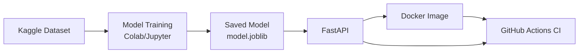

# Diabetes Prediction MLOps Pipeline

[](https://github.com/ayushs1901/diabetes-mlops-pipeline/actions/workflows/ci.yml)

## 1. Project Overview

This project serves a previously trained Random Forest model for the Pima Indians Diabetes Dataset from Kaggle. The model was trained separately in Colab/Jupyter and saved as `models/model.joblib`.

The FastAPI application validates eight input features and returns a binary prediction. Pytest checks the API, Docker packages the application and model, and GitHub Actions runs tests and builds the image.

Educational use only. This project is not a medical device, and its predictions are not a diagnosis.

## 2. Tech Stack

- Python 3.11 (Docker image and GitHub Actions)
- FastAPI and Pydantic for the HTTP API and request validation
- scikit-learn for the saved preprocessing and classification pipeline
- Joblib for loading the model artifact
- pandas for creating the named-feature prediction row
- pytest and FastAPI `TestClient` for automated tests
- Docker for container packaging
- GitHub Actions for continuous integration

The artifact records scikit-learn version `1.6.1`; this version is pinned in `requirements.txt`.

## 3. Project Workflow



The training notebook and source dataset are not included in this repository. Training details that cannot be confirmed from the saved model are not inferred here.

## 4. Project Structure

```text
diabetes-mlops-pipeline/
├── .github/
│   └── workflows/
│       └── ci.yml
├── models/
│   └── model.joblib
├── .gitignore
├── Dockerfile
├── main.py
├── README.md
├── requirements.txt
└── test_main.py
```

- `models/model.joblib` — fitted preprocessing/classification pipeline and metadata.
- `main.py` — loads the model and defines the API.
- `test_main.py` — API and input-validation tests.
- `requirements.txt` — pinned Python dependencies.
- `Dockerfile` — builds the API image with its model.
- `.github/workflows/ci.yml` — test and Docker-build workflow.
- `.gitignore` — excludes the virtual environment and generated Python/test files.

## 5. Model Details

The artifact contains a scikit-learn `Pipeline` with a median `SimpleImputer` followed by a `RandomForestClassifier`. The classifier has 100 trees, uses the Gini criterion, `max_features="sqrt"`, and `random_state=42`. The artifact also stores feature names, target names (`No Diabetes`, `Diabetes`), and the scikit-learn version (`1.6.1`).

The API supplies features in this order:

1. `Pregnancies`
2. `Glucose`
3. `BloodPressure`
4. `SkinThickness`
5. `Insulin`
6. `BMI`
7. `DiabetesPedigreeFunction`
8. `Age`

The API accepts non-negative values; it does not convert zero values to missing values. Median imputation applies to NaN values in the saved pipeline.

Training/test split details and evaluation metrics are not included in the repository and have not been verified.

## 6. Installation and Execution

Run these commands in PowerShell:

```powershell
git clone https://github.com/ayushs1901/diabetes-mlops-pipeline.git
cd diabetes-mlops-pipeline
py -3.11 -m venv .venv
.\.venv\Scripts\Activate.ps1
python -m pip install -r requirements.txt
```

Start the API:

```powershell
python -m uvicorn main:app --reload
```

Open Swagger UI at [http://127.0.0.1:8000/docs](http://127.0.0.1:8000/docs).

Build and run the Docker image:

```powershell
docker build -t diabetes-mlops-api:local .
docker run --name diabetes-mlops-api -p 8000:8000 diabetes-mlops-api:local
```

Stop the container with `Ctrl+C`; remove it with:

```powershell
docker rm diabetes-mlops-api
```

## 7. API Endpoints

| Method | Path | Purpose |
|---|---|---|
| `GET` | `/` | Returns the API welcome message. |
| `GET` | `/health` | Reports API status and whether the model loaded. |
| `POST` | `/predict` | Validates eight features and returns a predicted class and label. |

`POST /predict` requires the following JSON body:

```json
{
  "Pregnancies": 2,
  "Glucose": 120,
  "BloodPressure": 70,
  "SkinThickness": 20,
  "Insulin": 79,
  "BMI": 32.0,
  "DiabetesPedigreeFunction": 0.47,
  "Age": 33
}
```

Example response verified against the current saved model:

```json
{
  "prediction": 0,
  "label": "not_diabetic"
}
```

The API maps class `0` to `not_diabetic` and class `1` to `diabetic`. Missing, negative, non-finite, or extra fields are rejected with HTTP `422`. Valid requests return HTTP `200`.

## 8. Automated Testing

Run the test suite from the repository root:

```powershell
python -m pytest -v
```

The tests cover all three endpoints, a valid prediction, negative values for each of the eight features, and a missing feature. The eight negative-value cases are parameterized, giving **12 test cases** in total. The suite passed locally with `12 passed`; the GitHub Actions run for commit `279c586` also passed.

## 9. GitHub Actions CI

The workflow in `.github/workflows/ci.yml` runs on pushes to `main` and on pull requests. It checks out the repository, sets up Python 3.11, installs `requirements.txt`, runs `python -m pytest -v`, and builds the Docker image.

The workflow builds the image but does not publish it to a container registry or deploy the application. The run for [commit `279c586`](https://github.com/ayushs1901/diabetes-mlops-pipeline/actions/runs/40632558147) completed successfully.
